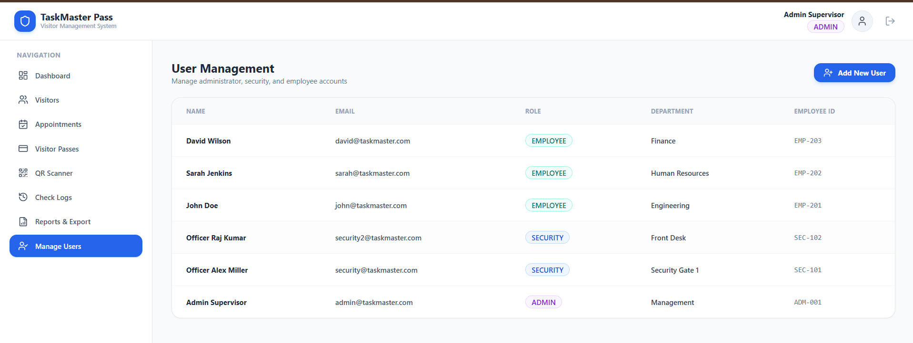
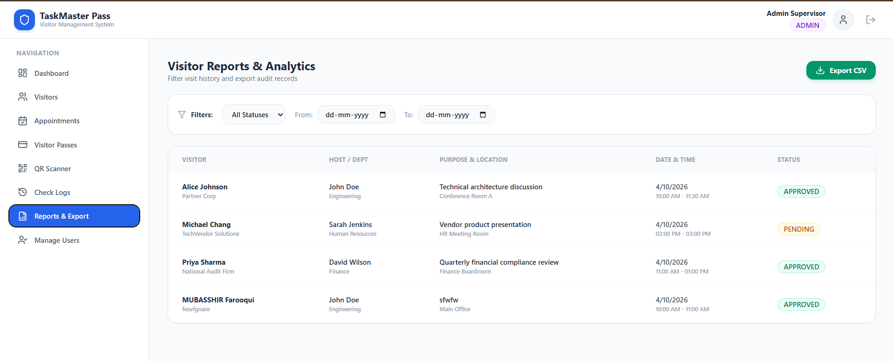
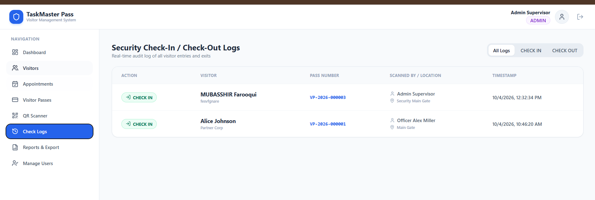
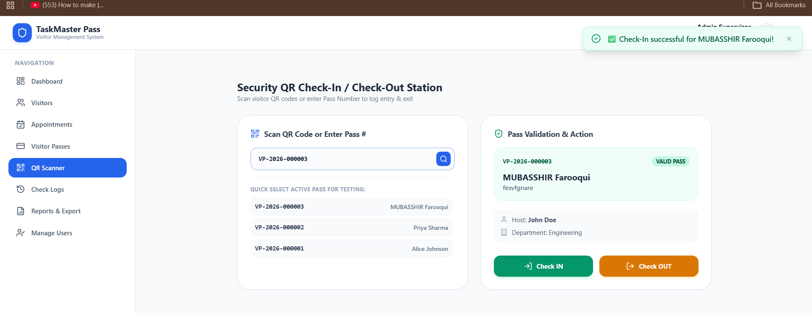
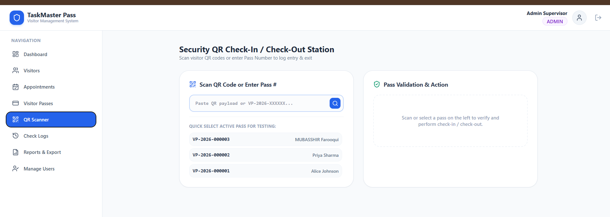
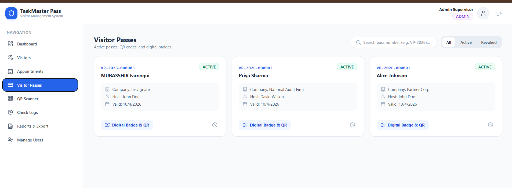
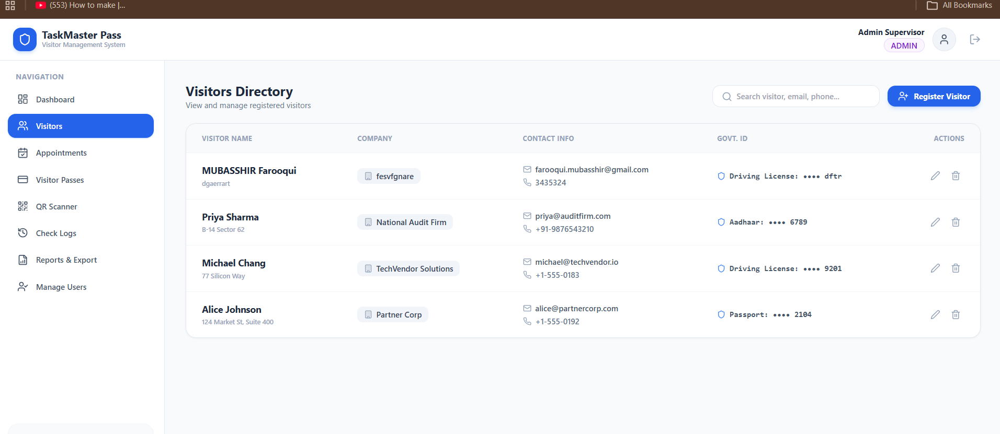
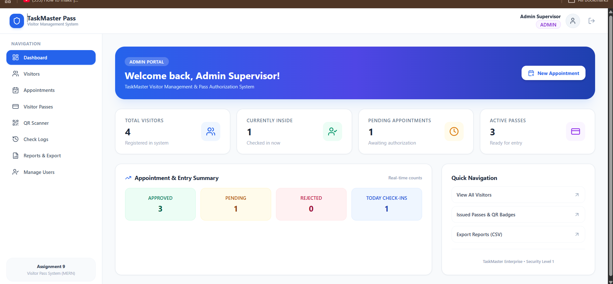

# Visitor Pass System Frontend (Assignment 9)

React.js web interface for the Visitor Pass Management System built with **Vite, React Router v6, Axios, Lucide Icons, and Tailwind CSS**.

## 🔗 GitHub Repositories
- **Frontend Repo:** [https://github.com/mubasshir-cyber/mernstack-assign-9-frontend.git](https://github.com/mubasshir-cyber/mernstack-assign-9-frontend.git)
- **Backend Repo:** [https://github.com/mubasshir-cyber/mernstack-assign-9-backend.git](https://github.com/mubasshir-cyber/mernstack-assign-9-backend.git)

## Tech Stack
- **Framework:** React 18 (Vite)
- **Routing:** React Router DOM v6
- **HTTP Client:** Axios (Centralized API client with JWT interceptor)
- **Icons:** Lucide React
- **Design:** Modern CSS & Tailwind CSS Design System

## Setup & Running

1. Navigate to frontend:
   ```bash
   cd frontend
   ```

2. Install dependencies:
   ```bash
   npm install
   ```

3. Start development server:
   ```bash
   npm run dev
   ```
   *(Access at `http://localhost:3000`)*

4. Build for production:
   ```bash
   npm run build
   ```

## Demo Credentials
| Role | Email | Password |
| :--- | :--- | :--- |
| **ADMIN** | `admin@taskmaster.com` | `admin123` |
| **SECURITY** | `security@taskmaster.com` | `security123` |
| **EMPLOYEE** | `john@taskmaster.com` | `employee123` |
| **EMPLOYEE** | `sarah@taskmaster.com` | `employee123` |












